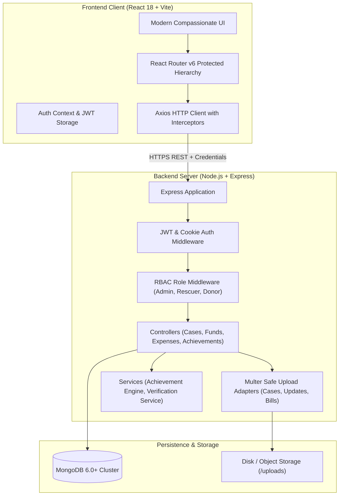
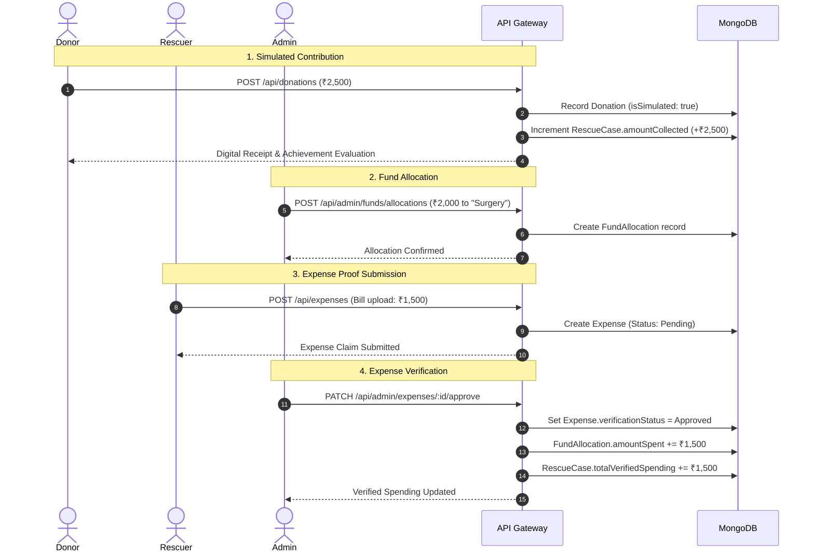

# Pet Rescue — High-Level Technical Architecture

## 1. Overview & System Purpose
Pet Rescue is an emergency animal welfare and simulated campaign financing coordination platform designed to bridge stray animal rescue triage, veterinary treatments, donor accountability, and administrative governance.

The platform provides:
- **Emergency Case Intake:** Rescuers document animal trauma, capture clinical diagnoses, GPS locations, and treatment surgery cost estimates.
- **Administrative Triage & Verification:** Multi-tier review verifying clinical estimates before public fundraising campaigns go live.
- **Simulated Community Donations:** Simulated digital pledges with unique transaction references (`SIM-YYYYMMDD-XXXXXX`), downloadable receipts, and public honor rolls.
- **Financial Transparency & Allocation Ledger:** Escrow balances allocated to categorized medical care (Surgery, Medicines, Shelter, etc.).
- **Expense Proof Auditing:** Rescuers upload scanned clinic bills and receipts against active allocations; admins audit and approve disbursements to increment verified spending.
- **Clinical Journal & Announcements:** Timeline updates with progress photos and platform-wide emergency alerts.
- **Donor Recognition & Leaderboard:** Milestone badges earned through idempotent evaluation, with opt-in public honor rolls and privacy settings.

---

## 2. High-Level Architecture Diagram

---

## 3. Frontend Architecture

### Directory Organization
- `client/src/components/`
  - `cards/`: `BaseCard`, `StatCard`, `RescueCaseCard`, `InfoCard`.
  - `common/`: `PrimaryButton`, `OutlineButton`, `AnnouncementBanner`.
  - `feedback/`: `ProgressBar`, `StatusBadge`, `NotificationDropdown`, `LoadingState`, `EmptyState`.
  - `forms/`: `FormInput`, `FormSelect`, `FormTextarea`.
  - `layout/`: `Navbar`, `Footer`, `Container`, `Section`, `Breadcrumbs`, `DashboardSidebar`, `ProfileDropdown`.
- `client/src/pages/`
  - Public: `HomePage`, `CasesPage`, `CaseDetailPage`, `TransparencyPage`, `LeaderboardPage`, `AnnouncementsPage`, `HowItWorksPage`.
  - Auth: `LoginPage`, `RegisterPage`.
  - Donor: `DonorDashboard`, `DonorAchievementsPage`, `DonorDonationsPage`, `DonationReceiptPage`.
  - Rescuer: `RescuerDashboard`, `MyCasesPage`, `NewCasePage`, `RescuerExpensesPage`, `NewExpensePage`, `RescuerCasesUpdatesPage`, `NewRescueUpdatePage`, `RescuerUpdatesHistoryPage`.
  - Admin: `AdminDashboard`, `AdminCasesPage`, `AdminCaseReviewPage`, `AdminFundsPage`, `AdminExpensesPage`, `AdminExpenseReviewPage`, `AdminRescueUpdatesPage`, `AdminAnnouncementsPage`, `AdminAchievementsPage`, `AdminDonationsPage`.
- `client/src/services/api.js`: Centralized Axios API service with credentials, error transforms, and authorization header fallback.

---

## 4. Backend Architecture

### Design Patterns
- **Modular Routing:** Routers organized in `server/routes/` and mounted under `/api`.
- **Role-Based Access Control (RBAC):** Middleware checks `verifyAuth` and `requireRoles(...)`.
- **Data Encapsulation:** Mongoose schemas enforce data validation, defaults, unique indexes, and sanitization before persistence.
- **Asynchronous Decoupling:** Heavy non-critical workflows (such as achievement milestone evaluations and notification triggers) run asynchronously without blocking core transactional API responses.

---

## 5. Database Schema & Data Models

1. **`User`**: Identity, credentials (bcrypt hash), role (`donor`, `rescuer`, `admin`), rescuer verification status (`pending`, `approved`, `rejected`), and recognition privacy settings (`showOnLeaderboard`, `displayName`, `showDonationTotal`).
2. **`RescueCase`**: Patient identifiers, species, location, injury type, urgency level (`Critical`, `Urgent`, `Normal`), treatment costs, fundraising target, amount collected, verified spending, and workflow states (`verificationStatus`, `campaignStatus`).
3. **`Donation`**: Simulated donation transactions, reference code (`SIM-YYYYMMDD-XXXXXX`), currency (`INR`), amount, anonymous flag, and idempotency key.
4. **`FundAllocation`**: Campaign fund earmarks categorized by treatment stage (`Surgery`, `Medicines`, `Shelter`, etc.), total allocation amount, and current amount spent.
5. **`Expense`**: Rescuer proof submission linked to an allocation, amount, description, proof documents metadata, and verification state (`Pending`, `Approved`, `Rejected`).
6. **`RescueUpdate`**: Recovery updates posted by rescuers, milestone types, description, images, and admin review status (`pending`, `published`, `rejected`).
7. **`Announcement`**: Broadcast alerts, severity level (`general`, `urgent`, `emergency`), scheduling windows (`startAt`, `expiresAt`), and state (`draft`, `published`, `archived`).
8. **`Achievement` & `UserAchievement`**: Milestone badge definitions and junction records with compound unique constraints `{ userId, achievementId }` preventing duplicate badge awards.
9. **`Notification`**: In-app notifications with recipient scoping, unread flags, and target resource linkage.
10. **`AuditLog`**: Tamper-evident admin review action tracking with timestamps and review notes.

---

## 6. Financial Simulation Workflow

---

## 7. Storage Architecture & Production Portability
- **Image/Document Uploads:** Handled via Multer disk storage locally with strict MIME validation (JPEG, PNG, WebP for images; PDF for medical bills) and 5MB / 10MB file size limits.
- **Production Portability:** Storage handlers are abstracted to permit seamless plug-and-play binding with S3-compatible cloud object stores (AWS S3, Google Cloud Storage, Cloudflare R2) via environment variables.

---

## 8. Academic Simulation Notice
All donation workflows, fund balances, escrow holdings, bank references, and badge recognition statistics represent educational simulation data. Live banking APIs, commercial payment gateways, and real monetary disbursements are strictly prohibited by architecture design.
